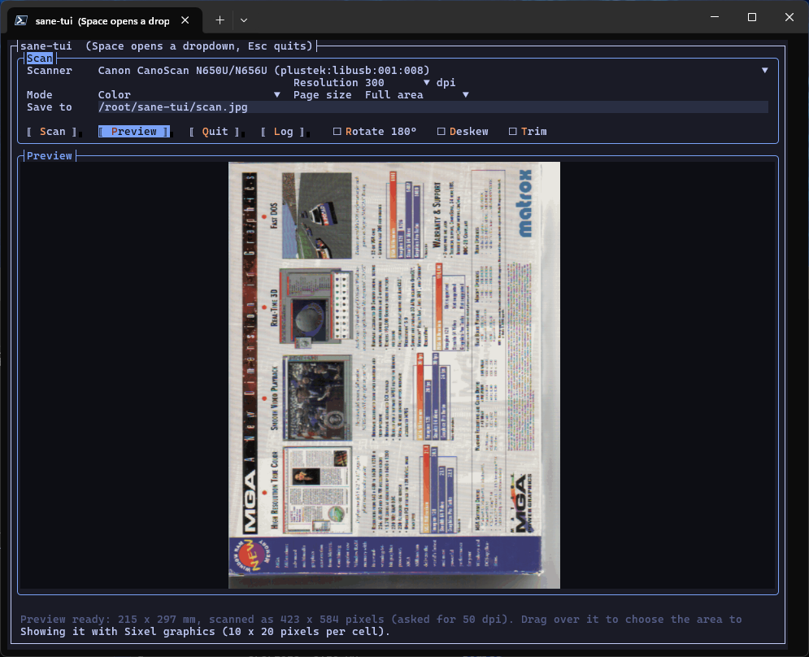
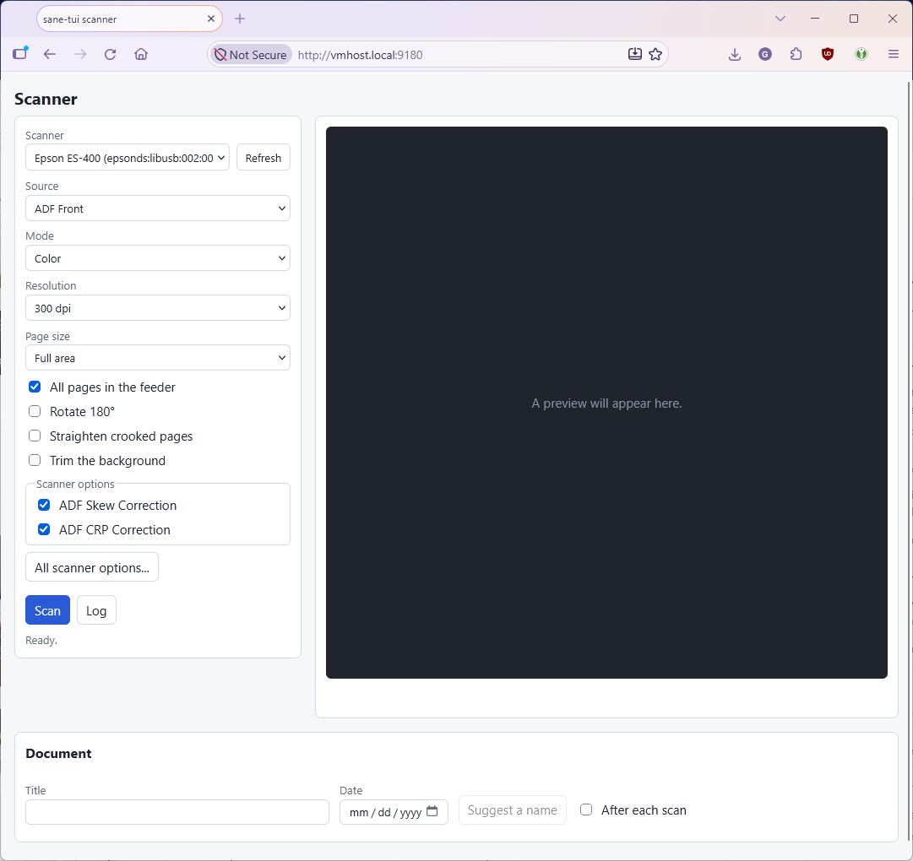
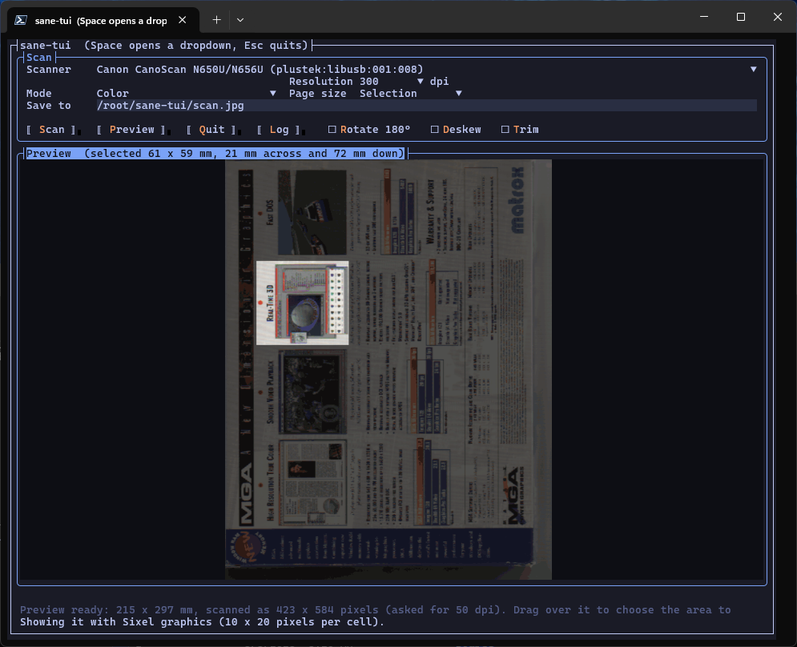

# sane-tui

[](https://github.com/godefroi/sane-tui/actions/workflows/ci.yml)
[](https://github.com/godefroi/sane-tui/releases)
[](LICENSE)

**Scan documents on Linux, from a terminal or a browser.** Built on [SANE](http://www.sane-project.org/) and a .NET library that talks to it directly. Think Skanlite or SimpleScan, without a desktop.

| In the terminal | In the browser |
|:---:|:---:|
|  |  |
| A flatbed preview, drawn as real pixels in a terminal that supports it | The web page, set up for a document feeder |

Status: early. It works with flatbed scanners and document feeders; expect rough edges and changes.

## What it does

- **Flatbeds and document feeders.** Preview the whole bed and drag out the area to scan, or scan every sheet in a feeder and watch the pages arrive.
- **The scanner's own choices.** Source, mode and resolution come from what the scanner reports, so you aren't offered what it can't do, and its other on/off options can be switched on from the web page.
- **Straighten, trim and turn the page** (`Deskew`, `Trim`, `Rotate 180°`), done on the scanner's raw pixels before the one JPEG encode.
- **PDF without a second round of compression.** The web page's PDF holds each JPEG exactly as it was saved.
- **Names for documents.** In the web page, a language model can suggest a title and date from the text of the first pages, if you give it an endpoint.
- **A library you can use on its own**, with an async API over SANE's one-thread-at-a-time design.

## What's here

| | |
|---|---|
| **[`SaneTui.Sane`](src/SaneTui.Sane/README.md)** | The library: list scanners, read and set their options, scan a page or a whole feeder, and get the pixels back. P/Invoke to `libsane`, no other dependencies. Published as a NuGet package, and meant to be useful on its own. |
| **[`sane-tui`](src/SaneTui/README.md)** | The terminal program: an interactive interface with a preview and area selection, plus `scan`, `diag` and `dump` commands. Scans to JPEG. |
| **[Web UI](src/SaneTui.Web/README.md)** | A web page and service for a scanner attached to a server: preview, area selection, feeder scans, PDF download, optional AI-suggested titles. Runs from a container image, behind a password. |
| [`SaneTui.Core`](src/SaneTui.Core/README.md) | The scanning code the terminal program and the web service share. Internal, not published. |
| [`tests`](tests/README.md) | The tests, and how to run them (the container is the easy way). |



*In the terminal program, drag over the preview to choose the area to scan (the rest is dimmed), then fine-tune it with the arrow keys.*

## Getting started

**The terminal program** is a download from the [releases page](https://github.com/godefroi/sane-tui/releases) (Linux, x64 and arm64): unpack it and run `./sane-tui`. [More](src/SaneTui/README.md).

**The web service** is a container image behind a password:

```sh
podman run --rm --device /dev/bus/usb --group-add keep-groups -p 8080:8080 \
  -e Web__Password=change-me -v sane-tui-data:/data ghcr.io/godefroi/sane-tui-web:latest
```

Then open <http://localhost:8080/>. [More, including settings and giving the container access to the scanner](src/SaneTui.Web/README.md).

**The library** is a NuGet package:

```csharp
await using var sane = await SaneLibrary.InitializeAsync();

var scanners = await sane.GetDevicesAsync();
await using var device = await sane.OpenAsync(scanners[0].Name);

await device.SetAsync(device.GetOption("resolution"), 300);

SaneImage page = await device.ScanAsync();
```

[More](src/SaneTui.Sane/README.md).

All three are made from the same release tag and share its version. [How a release is made](docs/releasing.md) is written down too.

## What they need

Linux, because SANE is, and SANE itself: the native library (`libsane1` on Debian and Ubuntu, `sane-backends` on Fedora) and the driver for your scanner. The code is .NET 10.

## Building

```sh
dotnet build sane-tui.slnx
dotnet run --project src/SaneTui       # the terminal program
```

Warnings are errors in every project. The [tests README](tests/README.md) covers running the tests.

## License

Apache 2.0, see [LICENSE](LICENSE).
